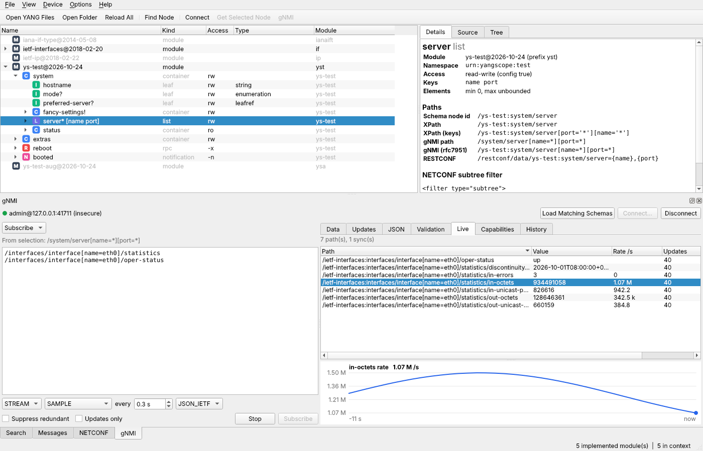
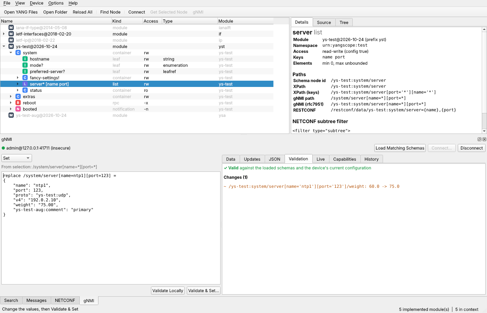
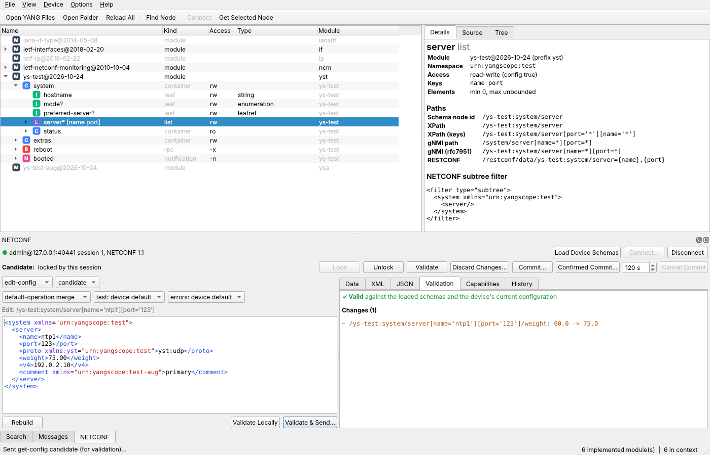
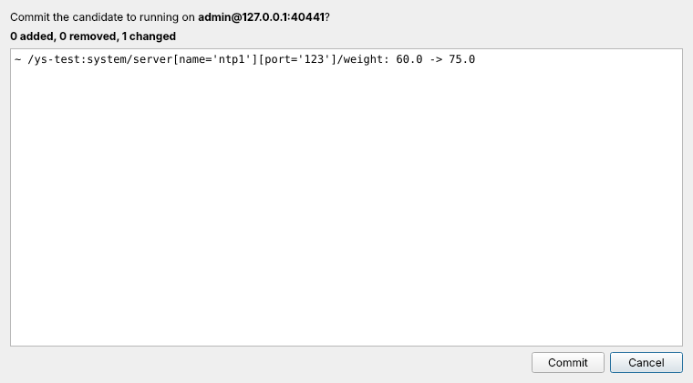
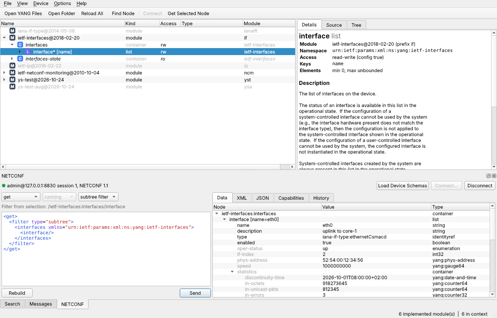

# YangScope

A native desktop explorer for YANG data models, written in C++ with Qt 6 and
[libyang](https://github.com/CESNET/libyang). No Java, no browser, no Docker.


Existing YANG explorers are either web applications (YANG Suite, ANX,
Netopeer2GUI), Java-based (ANX), abandoned (Cisco yang-explorer, which needed
Flash) or offline-only. YangScope is a fast native tool for Linux, Windows and
macOS: browse schemas offline, then connect to a device over NETCONF or gNMI,
read its configuration and state, change it with local validation first, and
watch streaming telemetry.

## Status

**gNMI client (v0.4)**



- **Connect** over TLS (CA file or system trust store, optional client
  certificate for mutual TLS, TLS server-name override) or, for labs, without
  TLS. Username and password go in the call metadata, as devices expect.
  Target profiles are saved; passwords never are.
- **Capabilities:** gNMI version, encodings and models; *Load Matching
  Schemas* loads the listed models from your search directories (gNMI has no
  schema download, unlike NETCONF).
- **Get** with any path (completion from the loaded schemas), data type
  (ALL/CONFIG/STATE/OPERATIONAL) and encoding (JSON_IETF, JSON, PROTO, ASCII).
  Updates are placed into a typed libyang data tree whatever the target sends:
  container JSON, list arrays, wildcard results or single scalars, with or
  without module prefixes. Anything that does not fit the schemas stays visible
  in the Updates tab.
- **Set** written as `update`/`replace`/`delete` lines with JSON_IETF values,
  **validated locally before sending**: values against the schemas, then the
  resulting configuration (fetched with Get CONFIG) with mandatory, must/when,
  leafref and unique checks, in gNMI's order (deletes, replaces, updates).
  The same change preview as for NETCONF comes before anything is sent.
- **Subscribe** STREAM (SAMPLE, ON_CHANGE, TARGET_DEFINED), ONCE or POLL, with
  suppress-redundant and updates-only. The Live tab shows every path with its
  value, rate per second (from the target's timestamps) and update count, and
  graphs the selected value, or its rate for counters.
- From the Data tab: *Get This Entry*, *Subscribe to This Entry*, *Edit This
  Entry (Set)* and *Delete This Entry (Set)*.
- Optional at build time: without gRPC, YangScope builds with NETCONF only.



**Changing configuration (v0.3)**



- **edit-config, validated locally before anything is sent.** The edit is
  checked with libyang against the loaded schemas (unknown elements, wrong
  types, ranges, patterns, state data). When connected, YangScope also fetches
  the target datastore, applies the edit to a copy following the `nc:operation`
  semantics (merge, replace, create, delete, remove, and default-operation
  merge/replace/none) and validates the result: mandatory nodes, `must`/`when`,
  leafref targets, `unique`, min/max-elements, `create` on existing data and
  `delete` on missing data.
- **A change preview before sending:** every leaf that would be added, removed
  or changed, with old and new values. Nothing goes to the device until you
  confirm; an invalid edit needs an explicit "Send Anyway".
- **Candidate datastore workflow:** Lock / Unlock, device-side Validate,
  Discard Changes, Commit with a preview of what changes between running and
  candidate, Confirmed Commit with a rollback timer and a live countdown, and
  Cancel Commit. Shown when the device advertises `:candidate`; edits to
  running are offered only with `:writable-running`.
- **Work from the data:** right-click an entry in the reply's Data tab to
  *Filter on This Entry* (subtree or XPath, keys filled in), *Edit This
  Entry* (its configuration with ancestors and keys, state data left out) or
  *Delete This Entry*. From the schema tree, *NETCONF Edit-Config* gives a
  skeleton with the keys to fill in.
- test-option and error-option are offered as advertised (`:validate`,
  `:rollback-on-error`).



**Phase 2 – NETCONF client (v0.2)**



- NETCONF over SSH (RFC 6241/6242) with both base:1.0 end-of-message and
  base:1.1 chunked framing, on libssh – so it runs on Linux, Windows and macOS.
- Authentication by password (with keyboard-interactive fallback, which many
  network devices need), private key file, or SSH agent / default keys.
  `~/.ssh/config` is honoured. Host keys are checked against
  `~/.ssh/known_hosts`; unknown keys show their SHA256 fingerprint and must be
  accepted explicitly, changed keys are always refused.
- Device profiles (host, port, user, auth method, key file) are saved;
  passwords never are.
- **Load Device Schemas**: reads the module list from the hello, YANG library
  1.0 or 1.1 (NMDA), downloads every schema with RFC 6022 `get-schema` into a
  per-device cache and loads exactly what the device implements, with the
  features it advertises.
- `get` and `get-config` (running, plus candidate/startup when advertised) with
  a subtree or XPath filter built from the node selected in the schema tree;
  the request stays editable, and any other RPC can be written by hand.
- Replies as a typed data tree (parsed against the loaded schemas, list
  entries labelled with their keys, nodes without a schema flagged), pretty
  XML, and RFC 7951 JSON. Clicking a data node selects its schema node.
- `rpc-error` details, request history with timings, capabilities table.
- Everything network-related runs on a worker thread; long requests can be
  cancelled.

**Phase 1 – offline schema browser (v0.1)**

- Open single `.yang` files or whole folders (recursive), or drop them on the
  window. Imports and includes are resolved from the opened folders plus any
  extra search directories. Submodules are recognised and loaded through their
  main module.
- Lazy schema tree of every implemented module, pyang-style: `rw`/`ro`/`-x`/`-n`
  access, `?` optional, `*` lists and leaf-lists with their keys, `!` presence
  containers, `(choice)` and `:(case)`, augmented nodes with their module prefix.
- Details for any node: resolved type chain (`oc-yang:counter64 → uint64`),
  ranges, lengths, patterns, enum values, identity bases and derived
  identities, leafref targets, units, defaults, keys, min/max elements,
  `when`/`must`, `if-feature`, status, description and reference.
- Paths for every node, copyable from the right-click menu:
  XPath, XPath with key predicates, schema node id, gNMI path (plain and
  RFC 7951 prefixed), RESTCONF URL and a ready-made NETCONF subtree filter.
- Module view: revision, namespace, imports, includes, features (enabled or
  not), original source with YANG syntax highlighting, and the libyang tree
  output (exportable to a text file).
- Search across all modules by name, by path fragment
  (`neighbor/state/session-state`) or in descriptions, with regex support.
- Loads the complete OpenConfig model set (177 modules) in a few seconds.

**Planned** – see [TODO.md](TODO.md): editing values directly in the data tree,
NMDA `get-data`, NETCONF notifications, gNMI union_replace and extensions,
exporting live data.

## Usage

```
yangscope [options] [files or folders...]

  -p, --path <dir>       Add a search directory for imports (repeatable)
  -r, --recursive        Load folders and search directories recursively
  -f, --find <text>      Search for nodes after loading
  -s, --select <path>    Select a node, e.g. /ietf-interfaces:interfaces/interface
  -c, --connect <target> Connect to a NETCONF device: [user@]host[:port]
      --device-schemas   After connecting, download and load the device's schemas
      --get              After connecting, send a get for the --select node
      --gnmi <target>    Connect to a gNMI target: [user@]host[:port] (default 57400)
      --gnmi-insecure    gNMI without TLS (labs only)
      --gnmi-ca <file>   CA certificate (PEM) for gNMI TLS
      --gnmi-server-name <name>  Name to verify in the target's certificate
      --gnmi-schemas     After connecting, load the target's models from the search directories
      --subscribe        After connecting (gNMI), subscribe to the --select node
```

Connecting from the command line asks for the password (leave it empty to use
SSH keys). For scripts, `YANGSCOPE_NETCONF_PASSWORD` and
`YANGSCOPE_KNOWN_HOSTS` (a known_hosts file to use instead of
`~/.ssh/known_hosts`) can be set in the environment.

```
yangscope --connect admin@r1.lab:830 --device-schemas \
  -s /ietf-interfaces:interfaces/interface --get

# gNMI: OpenConfig models from a checkout, TLS with the lab CA
yangscope -r -p openconfig/release/models -p openconfig/third_party \
  --gnmi admin@leaf1.lab:57400 --gnmi-ca lab-ca.pem --gnmi-schemas \
  -s /openconfig-interfaces:interfaces/interface/state/counters --subscribe
```

`YANGSCOPE_GNMI_PASSWORD` sets the gNMI password for scripts.

Example with the OpenConfig repository:

```
git clone --depth 1 https://github.com/openconfig/public openconfig
yangscope -r -p openconfig/third_party openconfig/release/models \
  -s /openconfig-interfaces:interfaces/interface/state/counters
```

By default every feature of a loaded module is enabled (**Options → Enable
All Features**), so `if-feature` guarded nodes are visible.

## Building

Requirements: CMake ≥ 3.19, a C++17 compiler, Qt ≥ 6.4 (Core, Gui, Widgets),
libyang ≥ 2.1 and libssh ≥ 0.9; for gNMI also gRPC C++ and protobuf.
`-DYANGSCOPE_WITH_GNMI=AUTO|ON|OFF` (default AUTO: gNMI when gRPC is found). YangScope is tested with libyang 2.1.30 (Ubuntu 24.04
package) and libyang 6.4; API differences between versions are detected at
configure time.

### Linux (Debian/Ubuntu)

```
sudo apt install cmake g++ pkg-config qt6-base-dev libgl-dev libyang2-dev libssh-dev \
  libgrpc++-dev protobuf-compiler-grpc libprotobuf-dev protobuf-compiler
cmake -S . -B build -DCMAKE_BUILD_TYPE=Release
cmake --build build -j
ctest --test-dir build
./build/yangscope
```

Fedora/RHEL: `dnf install cmake gcc-c++ qt6-qtbase-devel libyang-devel libssh-devel grpc-devel grpc-plugins protobuf-devel`.

The NETCONF and GUI tests start a small Python test server
(`tests/netconf/test_server.py`, needs `paramiko`); without it they are
reported as skipped. The same server is handy for trying the GUI:

```
python3 tests/netconf/test_server.py --schemas tests/data --schemas tests/netconf/ietf \
  --data tests/netconf/data.xml --config tests/netconf/config.xml \
  --feature ietf-interfaces=if-mib --port 8830      # user admin, password admin
```

It keeps running and candidate datastores in memory, so edits, locks and
(confirmed) commits behave like on a device until it is restarted.

The gNMI tests use `tests/gnmi/test_server.py` (needs `grpcio`, `grpcio-tools`
and `cryptography`), which serves the same models as RFC 7951 JSON, applies
Sets, and makes the eth0 counters grow for streaming:

```
python3 tests/gnmi/test_server.py --port 57400 --user admin --password admin
python3 tests/gnmi/test_server.py --port 57400 --tls /tmp/certs   # writes ca.pem, server and client certs
```

Load `tests/data` and `tests/netconf/ietf` as search directories, then connect
with *Device → gNMI Connect* (insecure, or TLS with `/tmp/certs/ca.pem`).

### macOS

```
brew install qt libyang libssh grpc protobuf pkg-config
cmake -S . -B build -DCMAKE_PREFIX_PATH="$(brew --prefix qt)"
cmake --build build -j
```

### Windows

Install Qt 6 (MSVC 2022 build), and libyang, libssh and gRPC through vcpkg
(`vcpkg install libyang:x64-windows libssh:x64-windows grpc:x64-windows`; gRPC
takes a while to build the first time), then configure with the vcpkg
toolchain file:

```
cmake -S . -B build -DCMAKE_TOOLCHAIN_FILE=%VCPKG_ROOT%\scripts\buildsystems\vcpkg.cmake
cmake --build build --config Release
```

Newer libyang releases read a few internal YANG modules from disk when a
context is created. Bundled builds look for them in `yang/libyang` next to the
executable (Windows), `../share/yangscope/yang/libyang` (Linux AppImage) and
`Contents/Resources/yang/libyang` (macOS); the release workflow copies them
there.

### Release binaries

Pushing a tag like `v0.1.0` runs `.github/workflows/release.yml`, which builds
a Linux AppImage, a Windows zip and a macOS dmg and attaches them to a GitHub
release.

## Project layout

```
src/core/   libyang wrapper, node descriptions, NETCONF session/framing/XML,
            schema download, edit validation, gNMI paths/data/client
            (no GUI dependency)
src/gui/    Qt widgets: schema tree, search, NETCONF and gNMI panels and
            their worker threads, live graph
tests/      unit, live and offscreen GUI tests; tests/netconf and tests/gnmi
            hold the Python test servers
third_party/gnmi  gNMI protocol definitions (Apache-2.0)
packaging/  desktop entry and icon
```

## Licence

GPL-3.0-or-later. See [LICENSE](LICENSE). libyang is BSD-3-Clause licensed,
libssh LGPL-2.1, gRPC and the gNMI protos (`third_party/gnmi`) Apache-2.0,
protobuf BSD-3-Clause, and Qt is used under the LGPL. The IETF modules in
`tests/netconf/ietf` keep their own IETF Trust (Simplified BSD) notices.
