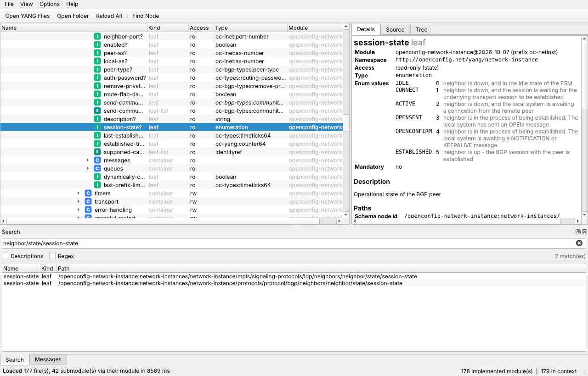

# YangScope

A native desktop explorer for YANG data models, written in C++ with Qt 6 and
[libyang](https://github.com/CESNET/libyang). No Java, no browser, no Docker.



Existing YANG explorers are either web applications (YANG Suite, ANX,
Netopeer2GUI), Java-based (ANX), abandoned (Cisco yang-explorer, which needed
Flash) or offline-only. YangScope aims to be a fast native tool for Linux,
Windows and macOS that starts with schema browsing and grows into live
NETCONF and gNMI exploration.

## Status

**Phase 1 – offline schema browser (this release)**

- Open single `.yang` files or whole folders (recursive), or drop them on the
  window. Imports and includes are resolved from the opened folders plus any
  extra search directories. Submodules are recognised and loaded through their
  main module.
- Lazy schema tree of every implemented module, pyang-style: `rw`/`ro`/`-x`/`-n`
  access, `?` optional, `*` lists and leaf-lists with their keys, `!` presence
  containers, `(choice)` and `:(case)`, augmented nodes with their module prefix.
- Details for any node: resolved type chain (`oc-yang:counter64 → uint64`),
  ranges, lengths, patterns, enum values, identity bases and derived
  identities, leafref targets, units, defaults, keys, min/max elements,
  `when`/`must`, `if-feature`, status, description and reference.
- Paths for every node, copyable from the right-click menu:
  XPath, XPath with key predicates, schema node id, gNMI path (plain and
  RFC 7951 prefixed), RESTCONF URL and a ready-made NETCONF subtree filter.
- Module view: revision, namespace, imports, includes, features (enabled or
  not), original source with YANG syntax highlighting, and the libyang tree
  output (exportable to a text file).
- Search across all modules by name, by path fragment
  (`neighbor/state/session-state`) or in descriptions, with regex support.
- Loads the complete OpenConfig model set (177 modules) in a few seconds.

**Planned** – see [TODO.md](TODO.md): NETCONF connections (get, get-config with
filters built by clicking nodes, edit-config validated by libyang first),
gNMI Capabilities/Get/Subscribe with live values and graphs, datastore diffs,
notification viewer.

## Usage

```
yangscope [options] [files or folders...]

  -p, --path <dir>       Add a search directory for imports (repeatable)
  -r, --recursive        Load folders and search directories recursively
  -f, --find <text>      Search for nodes after loading
  -s, --select <path>    Select a node, e.g. /ietf-interfaces:interfaces/interface
```

Example with the OpenConfig repository:

```
git clone --depth 1 https://github.com/openconfig/public openconfig
yangscope -r -p openconfig/third_party openconfig/release/models \
  -s /openconfig-interfaces:interfaces/interface/state/counters
```

By default every feature of a loaded module is enabled (**Options → Enable
All Features**), so `if-feature` guarded nodes are visible.

## Building

Requirements: CMake ≥ 3.19, a C++17 compiler, Qt ≥ 6.4 (Core, Gui, Widgets)
and libyang ≥ 2.1. YangScope is tested with libyang 2.1.30 (Ubuntu 24.04
package) and libyang 6.4; API differences between versions are detected at
configure time.

### Linux (Debian/Ubuntu)

```
sudo apt install cmake g++ pkg-config qt6-base-dev libgl-dev libyang2-dev
cmake -S . -B build -DCMAKE_BUILD_TYPE=Release
cmake --build build -j
ctest --test-dir build
./build/yangscope
```

Fedora/RHEL: `dnf install cmake gcc-c++ qt6-qtbase-devel libyang-devel`.

### macOS

```
brew install qt libyang pkg-config
cmake -S . -B build -DCMAKE_PREFIX_PATH="$(brew --prefix qt)"
cmake --build build -j
```

### Windows

Install Qt 6 (MSVC 2022 build) and libyang through vcpkg
(`vcpkg install libyang:x64-windows`), then configure with the vcpkg toolchain
file:

```
cmake -S . -B build -DCMAKE_TOOLCHAIN_FILE=%VCPKG_ROOT%\scripts\buildsystems\vcpkg.cmake
cmake --build build --config Release
```

Newer libyang releases read a few internal YANG modules from disk when a
context is created. Bundled builds look for them in `yang/libyang` next to the
executable (Windows), `../share/yangscope/yang/libyang` (Linux AppImage) and
`Contents/Resources/yang/libyang` (macOS); the release workflow copies them
there.

### Release binaries

Pushing a tag like `v0.1.0` runs `.github/workflows/release.yml`, which builds
a Linux AppImage, a Windows zip and a macOS dmg and attaches them to a GitHub
release.

## Project layout

```
src/core/   libyang wrapper and node descriptions (no GUI dependency)
src/gui/    Qt widgets: schema tree model, search panel, main window
tests/      core tests with small YANG modules in tests/data
packaging/  desktop entry and icon
```

## Licence

GPL-3.0-or-later. See [LICENSE](LICENSE). libyang is BSD-3-Clause licensed;
Qt is used under the LGPL.
